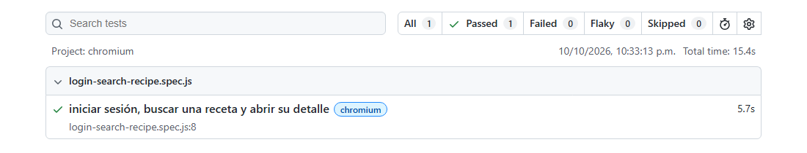

# Tests automatizados

Qué se prueba, cómo se corre y la evidencia de la ejecución. Cubre lo que pide la cátedra para
la aprobación: 1 test por integrante y 1 de integración en el backend, y 1 test unitario de un
componente y 1 end-to-end en el frontend.

## Resumen

| Paquete | Tipo | Archivo | Qué prueba | Parte ([guía](guia-defensa.md)) |
|---|---|---|---|:-:|
| Backend | Unitario | [donationService.test.ts](../backend/src/features/donation/services/donationService.test.ts) | CU donaciones: el estado de una donación según los pagos de Mercado Pago (`statusFromPayments`) y el resumen del historial: total, promedio y top 5, solo con las completadas (`buildHistorySide`) | A |
| Backend | Unitario | [recipeNutritionService.test.ts](../backend/src/features/recipe/services/recipeNutritionService.test.ts) | Valores nutricionales por porción: suma por ingrediente, división por porciones, ingredientes sin cantidad o en otra unidad | C |
| Backend | Unitario | [pantryMatchService.test.ts](../backend/src/features/search/services/pantryMatchService.test.ts) | CU recetas según ingredientes: qué falta y qué no alcanza del inventario, y el orden de "más cocinable" a "menos" | C |
| Backend | Unitario (con mocks) | [reviewService.test.ts](../backend/src/features/review/services/reviewService.test.ts) | CU reseñar recetas: no se reseña una receta propia ni dos veces la misma, y la receta tiene que existir. Los repositorios se reemplazan por mocks (`vi.mock`) | D |
| Backend | Integración | [app.integration.test.ts](../backend/src/app.integration.test.ts) | Pedidos HTTP reales a la app con Supertest: errores en JSON (404, 400, 401, 422) y, contra la base de test, registro → login → ruta protegida con el token, registro duplicado (409) y contraseña incorrecta (401) | D |
| Frontend | Componente | [ErrorState.test.jsx](../frontend/src/core/components/ErrorState.test.jsx) | `ErrorState` muestra el título y el mensaje, y el botón "Reintentar" llama a `onRetry` (input y output property) | B |
| Frontend | End-to-end | [login-search-recipe.spec.js](../frontend/e2e/login-search-recipe.spec.js) | En un navegador real: inicia sesión con `juanperez`, busca "fideos" y abre el detalle de "Fideos con tuco" | B |

## Herramientas

| Herramienta | Para qué | Dónde |
|---|---|---|
| [Vitest](https://vitest.dev) | Corre los tests unitarios, de integración y de componente | `backend/vitest.config.mts`, bloque `test` de `frontend/vite.config.js` |
| [Supertest](https://github.com/ladjs/supertest) | Hace pedidos HTTP a la app de Express sin levantar el servidor (`app.ts` la exporta sin `listen`) | Test de integración |
| [Testing Library](https://testing-library.com) + jsdom | Renderiza el componente en un DOM simulado y lo usa como un usuario (buscar por texto o rol, hacer click) | Test de componente |
| [Playwright](https://playwright.dev) | Abre la app en Chromium y la recorre de punta a punta | `frontend/playwright.config.js`, carpeta `frontend/e2e/` |

Los tests del backend y el de componente están junto al archivo que prueban (`*.test.ts`,
`*.test.jsx`). Los del backend quedan fuera del build (`exclude` en `tsconfig.json`).

## Ambientes

| Ambiente | Archivo | Base | Lo usan |
|---|---|---|---|
| Desarrollo | `backend/.env` | `chefcito`, con `demo-seed.sql` | `npm run dev` y el test end-to-end |
| Test | `backend/.env.test` (copia de `.env.test.example`) | `chefcito_test`, aparte | El test de integración |

El test de integración escribe en la base (crea un usuario y al final lo borra), así que nunca
usa la de desarrollo. `vitest.config.mts` carga `.env.test` antes de que `app.ts` cargue `.env`.
`dotenv` no pisa una variable que ya está definida, así que la app queda conectada a
`chefcito_test`. Si `.env.test` no existe, la parte que usa la base se saltea y el resto corre
igual.

## Cómo se corren

Backend:

```bash
cd backend
npm run test:db   # solo la primera vez (o si cambia schema.prisma): crea la base de test y sus tablas
npm test
```

Frontend:

```bash
cd frontend
npm test
npx playwright install chromium   # solo la primera vez
npm run test:e2e
```

El test end-to-end necesita la base de desarrollo con `demo-seed.sql` cargado. Si el backend y
el frontend no están corriendo, Playwright los levanta. El reporte queda en
`frontend/playwright-report/` y se abre con `npx playwright show-report`.

## Evidencia de la ejecución

Corrida del 10/10/2026, en Windows 10 con Node.js 24 y MySQL 8 local.

### Backend: `npx vitest run --reporter=verbose`

```
 RUN  v5.0.3 C:/Users/Windows10/Desktop/FACULTAD/TERCER AÑO/DESARROLLO DE SOFTWARE/tp-chefcito/backend

 ✓ src/features/search/services/pantryMatchService.test.ts > computePantryMatch > la receta es completa si el inventario tiene todo en cantidad suficiente 5ms
 ✓ src/features/search/services/pantryMatchService.test.ts > computePantryMatch > distingue el ingrediente que falta del que no alcanza 1ms
 ✓ src/features/search/services/pantryMatchService.test.ts > computePantryMatch > un ingrediente con cantidad 0 en el inventario cuenta como faltante 0ms
 ✓ src/features/search/services/pantryMatchService.test.ts > computePantryMatch > si el inventario no tiene cantidad cargada, alcanza con tener el ingrediente 0ms
 ✓ src/features/search/services/pantryMatchService.test.ts > computePantryMatch > una receta sin ingredientes cargados nunca cuenta como completa 0ms
 ✓ src/features/search/services/pantryMatchService.test.ts > comparePantryMatches > ordena primero las completas, después por porcentaje y después por menos faltantes 1ms
 ✓ src/features/recipe/services/recipeNutritionService.test.ts > computeRecipeNutrition > suma lo que aporta cada ingrediente y lo divide por las porciones 5ms
 ✓ src/features/recipe/services/recipeNutritionService.test.ts > computeRecipeNutrition > muestra los nutrientes en el orden fijo de la tabla (Calorías antes que Proteínas) 1ms
 ✓ src/features/recipe/services/recipeNutritionService.test.ts > computeRecipeNutrition > sin porciones indicadas, el valor por porción es el de la receta entera 2ms
 ✓ src/features/recipe/services/recipeNutritionService.test.ts > computeRecipeNutrition > un ingrediente sin cantidad ("a gusto") no suma y deja el dato incompleto 1ms
 ✓ src/features/recipe/services/recipeNutritionService.test.ts > computeRecipeNutrition > ignora un valor cargado en otra unidad, porque no se puede convertir 1ms
 ✓ src/features/recipe/services/recipeNutritionService.test.ts > computeRecipeNutrition > acepta las cantidades como texto, como llegan los Decimal de Prisma 1ms
 ✓ src/features/review/services/reviewService.test.ts > createReview > crea la reseña si la receta es de otro usuario y todavía no la reseñó 8ms
 ✓ src/features/review/services/reviewService.test.ts > createReview > no deja reseñar una receta propia 1ms
 ✓ src/features/review/services/reviewService.test.ts > createReview > no deja reseñar dos veces la misma receta 1ms
 ✓ src/features/review/services/reviewService.test.ts > createReview > responde recipe_not_found si la receta no existe 1ms
 ✓ src/features/donation/services/donationService.test.ts > statusFromPayments > sin ningún pago todavía, no hay estado para actualizar 3ms
 ✓ src/features/donation/services/donationService.test.ts > statusFromPayments > si algún intento se aprobó, la donación está completada 1ms
 ✓ src/features/donation/services/donationService.test.ts > statusFromPayments > un pago en proceso deja la donación pendiente 0ms
 ✓ src/features/donation/services/donationService.test.ts > statusFromPayments > si todos los intentos fallaron, la donación queda rechazada 0ms
 ✓ src/features/donation/services/donationService.test.ts > buildHistorySide > cuenta solo las completadas en el total, la cantidad y el promedio 3ms
 ✓ src/features/donation/services/donationService.test.ts > buildHistorySide > suma las donaciones de una misma persona y ordena el top de mayor a menor 1ms
 ✓ src/features/donation/services/donationService.test.ts > buildHistorySide > el top muestra como máximo 5 personas 1ms
 ✓ src/features/donation/services/donationService.test.ts > buildHistorySide > sin donaciones completadas, el promedio es 0 1ms
stdout | src/app.integration.test.ts
◇ injected env (0) from .env // tip: ⌘ enable debugging { debug: true }

 ✓ src/app.integration.test.ts > API sin base de datos: respuestas de error en JSON > una ruta inexistente responde 404 con un mensaje 37ms
 ✓ src/app.integration.test.ts > API sin base de datos: respuestas de error en JSON > un JSON mal formado responde 400 sin mostrar detalles internos 22ms
 ✓ src/app.integration.test.ts > API sin base de datos: respuestas de error en JSON > una ruta protegida sin token responde 401 6ms
 ✓ src/app.integration.test.ts > API sin base de datos: respuestas de error en JSON > un token inválido también responde 401 5ms
 ✓ src/app.integration.test.ts > API sin base de datos: respuestas de error en JSON > un registro vacío responde 422 con el error de cada campo obligatorio 12ms
 ✓ src/app.integration.test.ts > API con la base de test: registro, login y ruta protegida > registra un usuario, inicia sesión y con el token accede a su perfil 247ms
 ✓ src/app.integration.test.ts > API con la base de test: registro, login y ruta protegida > el mismo usuario no se puede registrar dos veces (409 con el campo) 8ms
 ✓ src/app.integration.test.ts > API con la base de test: registro, login y ruta protegida > una contraseña incorrecta responde 401 sin decir si el usuario existe 68ms

 Test Files  5 passed (5)
      Tests  32 passed (32)
   Start at  22:32:52
   Duration  3.50s (import 52%, transform 34%, tests 12%, worker 2%)
```

La línea `injected env (0) from .env` es de `dotenv`: muestra que el `.env` de desarrollo no
cargó ninguna variable, porque ya estaban definidas las de `.env.test`.

### Frontend, componente: `npx vitest run --reporter=verbose`

```
 RUN  v5.0.3 C:/Users/Windows10/Desktop/FACULTAD/TERCER AÑO/DESARROLLO DE SOFTWARE/tp-chefcito/frontend

 ✓ src/core/components/ErrorState.test.jsx > ErrorState > muestra el título por defecto y el mensaje de error que recibe 170ms
 ✓ src/core/components/ErrorState.test.jsx > ErrorState > muestra un título propio si se lo pasan 6ms
 ✓ src/core/components/ErrorState.test.jsx > ErrorState > al tocar "Reintentar" llama a onRetry (output property) 32ms
 ✓ src/core/components/ErrorState.test.jsx > ErrorState > sin onRetry no muestra el botón 3ms

 Test Files  1 passed (1)
      Tests  4 passed (4)
   Start at  22:33:09
   Duration  2.67s (environment 74%, import 15%, tests 9%, transform 1%, worker 1%)
```

### Frontend, end-to-end: `npm run test:e2e`

```
> playwright test


Running 1 test using 1 worker

  ok 1 [chromium] › e2e\login-search-recipe.spec.js:8:1 › iniciar sesión, buscar una receta y abrir su detalle (5.7s)

  1 passed (15.4s)
```

Reporte HTML de Playwright de esa corrida:


